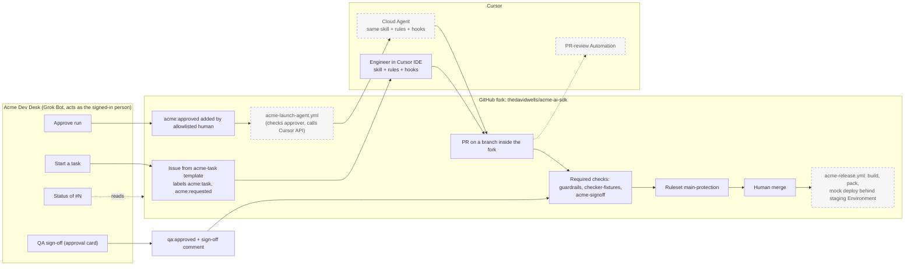

# Acme First Contribution Accelerator

This fork of [vercel/ai](https://github.com/vercel/ai) stands in for "Acme's core library." It adds a governed path from a request to a scoped, convention-correct pull request, with human approvals that GitHub records and enforces. Everything here uses the public repo, public docs, and public issues only. No upstream PRs are opened; all work stays in this fork.

Status as of Sat Oct 24, 11:41 AM MT. Rows marked Planned in the table below are not built or not yet run.

## The problem

- A first change in a large, unfamiliar repo is slow. This monorepo has 84 packages, and many of its conventions live in AGENTS.md, in individual files, or only in reviewers' heads. Newcomers guess, and reviewers re-teach the same conventions one PR at a time.
- A first change is also risky. Without guardrails, a newcomer or an agent can touch a second package, add an undeclared dependency, or edit CI and policy files.
- PM, QA, and DevOps can't easily start, track, or approve the work without living in the IDE or in GitHub.

## What this does

1. A teammate asks the **Acme Dev Desk** bot (a Grok Bot with the GitHub connector) to start, check, or sign off on a task.
2. The task becomes a GitHub issue from a template, and labels act as a visible state machine.
3. The agent or the engineer follows one repo skill (`skills/acme-first-contribution/SKILL.md`) and four small rules files layered on top of upstream AGENTS.md.
4. One deterministic checker (`tools/acme/check-contribution.mjs`) runs in the Cursor stop hook, in CI, and by hand. Hooks block edits to platform-owned paths.
5. QA signs off through the bot. A required check verifies that the person who added the label is on the approver list. Green means ready for a human to merge. Nothing merges or deploys automatically.

## How it works



Dashed boxes are planned or not yet run (see the table below). The IDE path is live today.

**Layers.** Rules give the agent context. The skill is the procedure. Hooks catch mistakes inside the agent loop. They are best effort, not a security boundary. The hard controls are in GitHub: required checks, the main ruleset, least-privilege workflow tokens, `pull_request` triggers (never `pull_request_target`), and approvals verified from the actor who added the label.

**What the checker enforces** (diff-aware, added lines only, so legacy code never blocks a newcomer):

| Check | Fails when |
|---|---|
| scope | A platform-owned path changes, or more than one package changes |
| boundary | A new dependency is added, or an import is not a declared dependency of the package, or a relative import escapes the package |
| convention | Added `JSON.parse` (use `parseJSON` / `safeParseJSON`), `require()`, or bare `zod` imports. `console.log` and `.optional()` vs `.nullish()` style drift only warn |
| deprecated | An added line uses a symbol marked `@deprecated` in core packages. The list is computed from JSDoc on every run |
| changeset | Code changed with no changeset naming the package, or a bump other than patch |
| tests | Source changed with no new test case, or new tests with no assertions. `.only` fails |

Every finding prints a `Fix:` line in plain English. A CODEOWNER can apply `acme:exception` to turn failures into logged exceptions, except for platform-path failures.

## How to run it

**1. Local, in the Cursor IDE (live).** Requires Node 22.13+ and pnpm 12.14.0.

```bash
pnpm install
pnpm exec turbo build --filter=@ai-sdk/cartesia^...
```

Then, in Agent chat: `/acme-first-contribution` with the issue number (for example #3). The skill restates scope, loads only the context it needs, plans, writes tests with the change, adds docs, an example, and a patch changeset, then runs the checks and fills the PR template. Hooks in `.cursor/hooks.json` deny edits to platform paths, reads of secrets files, network calls to hosts outside the allowlist, force pushes, pushes to main, and publishing.

**2. The checker by hand (same script CI runs).**

```bash
node tools/acme/check-contribution.mjs --base origin/main          # human-readable
node tools/acme/check-contribution.mjs --base origin/main --json   # machine-readable
node --test tools/acme/test/*.test.mjs                             # checker's own fixture tests
```

Exit code 0 means pass (warnings allowed). Exit code 1 means at least one failure.

**3. Acme Dev Desk bot intents.**

| Intent | Example | What the bot does |
|---|---|---|
| Start | "Start a task for @ai-sdk/cartesia: ..." | Collects package, problem, and acceptance criteria, then files an issue from the Acme template |
| Approve run | "Approve #N" | Shows scope and the checks that will run, asks for explicit approval, then adds `acme:approved` |
| Status | "Status of #4" | Reads labels, the linked PR, and check runs, then reports the stage, any failures with their messages, and the next human action |
| QA sign-off | "QA sign-off on #4: checked ..." | Refuses while required checks are red. Otherwise asks for approval, adds `qa:approved`, and posts `QA sign-off by <name>: <what was checked>` |

The bot acts as the signed-in person, so the GitHub label actor is the human who approved, not a bot account.

## Live vs mocked vs planned

| Piece | Status |
|---|---|
| Fork pinned to `fce9210`, real task from upstream issue #23430 | Live |
| Rules overlay, skill, hooks, checker, fixture tests | Live (merged in PR #2) |
| Local skill run in the Cursor IDE producing a 7-file PR | Live (PR #4) |
| Hook blocking an edit to a platform-owned path | Live (blocked an attempted edit to the skill's SKILL.md during the run) |
| CI: `guardrails`, `checker-fixtures` (required), upstream `verify-changesets` (advisory) | Live (green on PR #4, red on PR #5) |
| Required `acme-signoff` check verifying the label actor against `approvers.yml` | Live (PR #4) |
| Ruleset `main-protection`: PR required, four required checks, force pushes and deletion blocked | Live |
| Bot: status and QA sign-off | Live (PR #4, 11:36 AM MT) |
| Bot: start a task and approve a run end to end | Planned for Sunday (issue #3 was filed from the template in the GitHub UI) |
| Cloud Agent launched from the `acme:approved` label via the Cursor API (`acme-launch-agent.yml`, `tools/acme/cursor-agent.mjs`) | Planned for tonight, Sat Oct 24 (code merged, not yet run) |
| PR-review Automation posting one convention review comment | Planned for Sunday |
| Deploy: build and pack are real, publish is an echo behind a `staging` Environment with DevOps as required reviewer (`acme-release.yml`) | Mocked, and planned for Sunday (workflow merged; Environment not created; not yet run) |
| Acme people and roles | Synthesized (one account plays PM, QA, and DevOps) |
| Acme ticketing system | Stand-in (GitHub Issues) |
| Acme boundaries | Synthesized from real package dependencies plus a platform-owned path list |
| Bad change on `demo/red-guardrails` | Synthesized on purpose |

## Evidence

- Platform overlay merged: https://github.com/thedavidwells/acme-ai-sdk/pull/2
- Task issue filed from the template: https://github.com/thedavidwells/acme-ai-sdk/issues/3
- Good PR from the local skill run (7 files: options, model, API types, test, docs page, example, changeset): https://github.com/thedavidwells/acme-ai-sdk/pull/4
  - QA sign-off comment posted through the bot: https://github.com/thedavidwells/acme-ai-sdk/pull/4#issuecomment-6387397726
  - Passing `acme-signoff` after sign-off: https://github.com/thedavidwells/acme-ai-sdk/actions/runs/40116913494/job/120939975784
- Intentionally bad PR: https://github.com/thedavidwells/acme-ai-sdk/pull/5
  - `guardrails` fails with 7 findings, each with a Fix line: [scope] two packages; [boundary] undeclared `@ai-sdk/openai` import; [convention] raw `JSON.parse` (use `parseJSON` or `safeParseJSON`); [changeset] x2; [tests] x2: https://github.com/thedavidwells/acme-ai-sdk/actions/runs/40116121096/job/120937641267
  - The PR-title format rule also caught a bad title on the first run: https://github.com/thedavidwells/acme-ai-sdk/actions/runs/40115833145/job/120936793537
- Ruleset `main-protection`: https://github.com/thedavidwells/acme-ai-sdk/rules/25789506

## Known limits and production next steps

- **Sign-off revocation (fixed in [PR #6](https://github.com/thedavidwells/acme-ai-sdk/pull/6)).** `acme-signoff` now also requires `qa:approved` to be on the PR right now, so removing the label revokes the sign-off and turns the check red.
- **Identity.** In the demo, one GitHub account plays PM, QA, and DevOps, and a user API key will launch agents. In production: each person approves as themselves through the bot, a service-account key scoped to the repo launches agents, and Automations run as a service account.
- **Second-account test not done.** Labels added by a non-allowlisted user or a bot should be ignored, because the checks read the actor from the issue events API and filter on `actor.type == "User"` plus `approvers.yml`. This is enforced in code but not yet tested with a second account.
- **Code owner review not required yet.** CODEOWNERS covers `.github/`, `.cursor/`, `skills/acme-*`, `tools/acme/`, and `AGENTS.md`, but the ruleset does not yet require code owner review (a single account cannot approve its own PRs). Until then, a PR that edits a workflow runs its own edited copy. With code owner review required, that review is the gate.
- **Polling, not webhooks.** The launcher polls run status because Cloud Agents API v1 webhooks are not available yet. Switch to webhooks when they ship, and add retries with idempotency keys.
- **Hooks are best effort.** Hooks steer the agent and catch mistakes early, but they are not the boundary. CI and the ruleset are. Hook behavior inside Cloud Agents is verified when the Cloud Agent launch runs.
- **Narrow CI.** The fork runs a targeted subset (lint, konsistent, type-check, and tests for the touched package) instead of upstream's full matrix.
- **One package per first contribution.** Real cross-package work needs a `platform-change` PR or a stop-and-ask.
