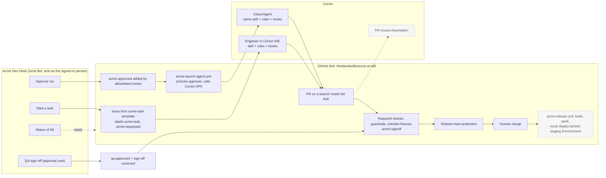

# Acme First Contribution Accelerator

This fork of [vercel/ai](https://github.com/vercel/ai) stands in for "Acme's core library." It adds a governed path from a request to a scoped, convention-correct pull request, with human approvals that GitHub records and enforces. Everything here uses the public repo, public docs, and public issues only. No upstream PRs are opened; all work stays in this fork.

Status as of Sun Oct 25, 2026 (`main` at `44ba027`). Rows marked Planned in the table below are not built or not yet run.

## The problem

- A first change in a large, unfamiliar repo is slow. This monorepo has 84 packages, and many of its conventions live in AGENTS.md, in individual files, or only in reviewers' heads. Newcomers guess, and reviewers re-teach the same conventions one PR at a time.
- A first change is also risky. Without guardrails, a newcomer or an agent can touch a second package, add an undeclared dependency, or edit CI and policy files.
- PM, QA, and DevOps can't easily start, track, or approve the work without living in the IDE or in GitHub.

## What this does

1. A teammate asks the **Acme Dev Desk** bot (a Grok Bot with the GitHub connector) to start, approve, check, or sign off on a task.
2. The task becomes a GitHub issue from a template, and labels act as a visible state machine.
3. When an allowlisted human approves, a GitHub Action launches a Cursor Cloud Agent through the Cursor API. An engineer can also run the same skill in the Cursor IDE.
4. The agent or the engineer follows one repo skill (`skills/acme-first-contribution/SKILL.md`) and four small rules files layered on top of upstream AGENTS.md.
5. One deterministic checker (`tools/acme/check-contribution.mjs`) runs in the Cursor stop hook, in CI, and by hand. Hooks block edits to most platform-owned paths (see Known limits).
6. QA signs off through the bot. A required check verifies that the person who added the label is on the approver list, for the current commit. Green means ready for a human to merge. Nothing merges or deploys automatically.

## How it works



Dashed boxes are planned or not yet run (see the table below). The IDE path and the API launch path are both live.

**Layers.** Rules give the agent context. The skill is the procedure. Hooks catch mistakes inside the agent loop. They are best effort, not a security boundary. The hard controls are in GitHub: required checks, the main ruleset, least-privilege workflow tokens, `pull_request` triggers (never `pull_request_target`), and approvals verified from the actor who added the label.

**What the checker enforces** (diff-aware, added lines only, so legacy code never blocks a newcomer):

| Check      | Fails when                                                                                                                                                        |
| ---------- | ----------------------------------------------------------------------------------------------------------------------------------------------------------------- |
| scope      | A platform-owned path changes, or more than one package changes                                                                                                   |
| boundary   | A new dependency is added, or an import is not a declared dependency of the package, or a relative import escapes the package                                     |
| convention | Added `JSON.parse` (use `parseJSON` / `safeParseJSON`), `require()`, or bare `zod` imports. `console.log` and `.optional()` vs `.nullish()` style drift only warn |
| deprecated | An added line uses a symbol marked `@deprecated` in core packages. The list is computed from JSDoc on every run                                                   |
| changeset  | Code changed with no changeset naming the package, or a bump other than patch                                                                                     |
| tests      | Source changed with no new test case, or new tests with no assertions. `.only` fails                                                                              |

Every finding prints a `Fix:` line in plain English. A CODEOWNER can apply `acme:exception` to turn failures into logged exceptions, except for platform-path failures.

**Platform-owned paths, as of `44ba027`.**

| Path                                                                                                                          | Checker `[scope]` (`check-contribution.mjs`) | `guard-write.mjs` hook  |
| ----------------------------------------------------------------------------------------------------------------------------- | -------------------------------------------- | ----------------------- |
| `.github/`, `.cursor/`, `.agents/`, `skills/`, `tools/`, `AGENTS.md`, `package.json`, `pnpm-lock.yaml`, `pnpm-workspace.yaml` | Fails                                        | Denies the edit         |
| `.claude/`, `.codex/`, `.changeset/config.json`, `packages/codemod/`, `content/docs/08-migration-guides/`                     | Fails                                        | Not covered (known gap) |

The checker is the source of truth. The hook list is shorter today; CI still catches those paths.

## How to run it

**1. Local, in the Cursor IDE (live).** Requires Node 22.13+ and pnpm 11 (`package.json` pins `pnpm@11.23.0`).

```bash
pnpm install
pnpm exec turbo build --filter=@ai-sdk/cartesia^...
```

Then, in Agent chat: `/acme-first-contribution` with the issue number (for example #3). The skill restates scope, loads only the context it needs, plans, writes tests with the change, adds docs, an example, and a patch changeset, then runs the checks and fills the PR template. Hooks in `.cursor/hooks.json` deny edits to platform paths (the hook list above), reads of secrets files, network calls to hosts outside the allowlist, force pushes, pushes to main, and publishing.

**2. Cloud Agent from an approved issue (live).** Ask the bot to start a task, then approve it. Adding `acme:approved` runs `.github/workflows/acme-launch-agent.yml` from `main`. It continues only if the label was added by a User (not a bot), the issue has `acme:task`, and the sender is in `.github/acme/approvers.yml`. It reads `CURSOR_API_KEY` from the `agent-launch` Environment (my personal key in the demo; see Known limits) and calls `POST /v1/agents` through `tools/acme/cursor-agent.mjs`, with `autoCreatePR: true`. A marker comment on the issue makes the launch idempotent. The workflow polls the run every 30 s (40 min timeout), then comments the PR link and moves the label to `acme:pr-open`.

The launcher fails loudly ([PR #9](https://github.com/thedavidwells/acme-ai-sdk/pull/9)). Stdout carries only the agent id or the final JSON; progress goes to stderr. The launch step fails unless the launcher returns a `bc-` agent id. A failed launch comments the Actions run link on the issue and adds `acme:needs-human`. A run that does not finish cleanly also adds `acme:needs-human`.

**3. The checker by hand (same script CI runs).**

```bash
node tools/acme/check-contribution.mjs --base origin/main          # human-readable
node tools/acme/check-contribution.mjs --base origin/main --json   # machine-readable
node --test tools/acme/test/*.test.mjs                             # checker's own fixture tests
```

Exit code 0 means pass (warnings allowed). Exit code 1 means at least one failure.

**4. Acme Dev Desk bot intents.**

| Intent      | Example                                  | What the bot does                                                                                                                             |
| ----------- | ---------------------------------------- | --------------------------------------------------------------------------------------------------------------------------------------------- |
| Start       | "Start a task for @ai-sdk/cartesia: ..." | Collects package, problem, and acceptance criteria, then files an issue from the Acme template                                                |
| Approve run | "Approve #N"                             | Shows scope and the checks that will run, asks for explicit approval, then adds `acme:approved`                                               |
| Status      | "Status of #4"                           | Reads labels, the linked PR, and check runs, then reports the stage, any failures with their messages, and the next human action              |
| QA sign-off | "QA sign-off on #4: checked ..."         | Refuses while required checks are red. Otherwise asks for approval, adds `qa:approved`, and posts `QA sign-off by <name>: <what was checked>` |

The bot acts as the signed-in person, so the GitHub label actor is the human who approved, not a bot account.

**QA sign-off is bound to a commit ([PR #8](https://github.com/thedavidwells/acme-ai-sdk/pull/8)).** The required `acme-signoff` check passes only when `qa:approved` is on the PR right now and the last human (`actor.type == "User"`) who added it is in `.github/acme/approvers.yml`. Any push (`synchronize`) fails the check for the new head commit. In parallel, `acme-signoff-reset.yml` removes `qa:approved` and comments "QA sign-off revoked: commit `<sha>` was pushed after approval." QA re-applies the label to approve the new commit. Removing the label by hand also revokes sign-off ([PR #6](https://github.com/thedavidwells/acme-ai-sdk/pull/6)).

## Why, cost, how we measure

- **Why:** one root cause (conventions in reviewers' heads) drives slow ramp, review churn, and boundary risk. PROPOSED: 40 to 50 first changers a year; cutting time to first clean merge from 3 to 4 weeks to about 2 is roughly 50 to 90 engineer-weeks a year of calendar time (to agree with Acme's platform lead).
- **Speed, one live run:** MEASURED: approval to launch comment about 15 s; PR opened about 2 minutes after approval (2m16s), report-back at about 3 minutes; launch job 2m56s. Timestamps: label 9:15:35 PM MT, PR 9:17:51 PM, report-back 9:18:32 PM.
- **Cost, one live run:** MEASURED: about 4m51s of Actions time (2m56s launch job plus about 1m55s CI); agent context about 46.1K of 256K. No token or dollar figure yet (the usage endpoint reports 0; see Known limits). Agents launch only on a human approval, one per issue.
- **CI on that PR:** MEASURED: `guardrails` 1m41s green, `checker-fixtures` 6s green, `acme-signoff` 8s red on purpose (not signed off).
- **How we measure a pilot:** PROPOSED: at least 80% of PRs pass guardrails on the first run, median review rounds at or below 2, convention comments down at least 50%, zero boundary violations on main, and at least 70% of PM/QA status and sign-off through the bot. Baseline first; stop or rescope if a 30-day cohort doesn't beat it.

## Live vs mocked vs planned

| Piece                                                                                                                                               | Status                                                                             |
| --------------------------------------------------------------------------------------------------------------------------------------------------- | ---------------------------------------------------------------------------------- |
| Fork pinned to `fce9210`, real task from upstream issue #23430                                                                                      | Live                                                                               |
| Rules overlay, skill, hooks, checker, fixture tests                                                                                                 | Live (merged in PR #2)                                                             |
| Local skill run in the Cursor IDE producing a 7-file PR                                                                                             | Live (PR #4)                                                                       |
| Hook blocking an edit to a platform-owned path                                                                                                      | Live (blocked an attempted edit to the skill's SKILL.md during the run)            |
| CI: `guardrails`, `checker-fixtures` (required), upstream `verify-changesets` (advisory)                                                            | Live (green on PR #4 and PR #11, red on PR #5)                                     |
| Required `acme-signoff` check verifying the label actor against `approvers.yml`, bound to the current commit                                        | Live (PR #4; commit-bound since PR #8)                                             |
| Ruleset `main-protection`: PR required, three required checks (`guardrails`, `checker-fixtures`, `acme-signoff`), force pushes and deletion blocked | Live                                                                               |
| Bot: status and QA sign-off                                                                                                                         | Live (PR #4, Sat Oct 24, 11:36 AM MT)                                              |
| Bot: start a task and approve a run end to end                                                                                                      | Live (issue #10 filed by the bot; approved through the bot Sat Oct 24, 9:15 PM MT) |
| Cloud Agent launched from the `acme:approved` label via the Cursor API (`acme-launch-agent.yml`, `tools/acme/cursor-agent.mjs`)                     | Live (one run: issue #10 to agent PR #11; launcher fixes in PR #9)                 |
| PR-review Automation posting one convention review comment                                                                                          | Planned (optional)                                                                 |
| Deploy: build and pack are real, publish is an echo behind a `staging` Environment with DevOps as required reviewer (`acme-release.yml`)            | Mocked, and planned (workflow merged; Environment not created; not yet run)        |
| Acme people and roles                                                                                                                               | Synthesized (one account plays PM, QA, and DevOps)                                 |
| Acme ticketing system                                                                                                                               | Stand-in (GitHub Issues)                                                           |
| Acme boundaries                                                                                                                                     | Synthesized from real package dependencies plus a platform-owned path list         |
| Bad change on `demo/red-guardrails`                                                                                                                 | Synthesized on purpose                                                             |

## Evidence

- Platform overlay merged: https://github.com/thedavidwells/acme-ai-sdk/pull/2
- Task issue filed from the template: https://github.com/thedavidwells/acme-ai-sdk/issues/3
- Good PR from the local skill run (7 files: options, model, API types, test, docs page, example, changeset): https://github.com/thedavidwells/acme-ai-sdk/pull/4
  - QA sign-off comment posted through the bot: https://github.com/thedavidwells/acme-ai-sdk/pull/4#issuecomment-6387397726
  - Passing `acme-signoff` after sign-off: https://github.com/thedavidwells/acme-ai-sdk/actions/runs/40116913494/job/120939975784
- Intentionally bad PR: https://github.com/thedavidwells/acme-ai-sdk/pull/5
  - `guardrails` fails with 7 findings, each with a Fix line: [scope] two packages; [boundary] undeclared `@ai-sdk/openai` import; [convention] raw `JSON.parse` (use `parseJSON` or `safeParseJSON`); [changeset] x2; [tests] x2: https://github.com/thedavidwells/acme-ai-sdk/actions/runs/40116121096/job/120937641267
  - The PR-title format rule also caught a bad title on the first run: https://github.com/thedavidwells/acme-ai-sdk/actions/runs/40115833145/job/120936793537
- Commit-bound QA sign-off merged: https://github.com/thedavidwells/acme-ai-sdk/pull/8
- Launcher prints clean JSON and fails loudly, merged: https://github.com/thedavidwells/acme-ai-sdk/pull/9
- API-launched run, end to end:
  - Task issue filed and approved through the bot: https://github.com/thedavidwells/acme-ai-sdk/issues/10
  - Launch workflow run: https://github.com/thedavidwells/acme-ai-sdk/actions/runs/40157549149
  - Cloud Agent: https://cursor.com/agents/bc-27641ebd-0b5f-4879-a29e-c339d2c6cd46
  - Agent PR (1 file, `CONTRIBUTING.md`, +1 -1; left unsigned on purpose): https://github.com/thedavidwells/acme-ai-sdk/pull/11
- Ruleset `main-protection`: https://github.com/thedavidwells/acme-ai-sdk/rules/25789506

## Known limits and production next steps

- **Self sign-off.** In the demo one GitHub account is requester, approver, PR author, and QA. Because the launcher runs on my personal key, the agent's PRs are authored as me too (PR #11), so the PR author and the `qa:approved` label actor would both be `thedavidwells`. Nothing stops the label actor from being the PR author. Production: fail `acme-signoff` when the label actor equals the PR author, and give each role a separate person.
- **Sign-off allowlist comes from the PR, not main.** The `acme-signoff` job (`acme-guardrails.yml`) runs on `pull_request` and does a sparse checkout of `.github/acme` with no `ref`, so it reads `approvers.yml` from the PR's merge ref (the PR's changes on top of main). A PR that edits `approvers.yml` is judged against its own edited list. This is from reading the code, not tested live. Fix: read the list with `git show origin/<base>:.github/acme/approvers.yml`, as the `acme:exception` and `platform-change` steps already do for CODEOWNERS. The launch workflow doesn't have this gap: issue events run from main.
- **Code owner review not required yet.** CODEOWNERS covers `.github/`, `.cursor/`, `skills/acme-*`, `tools/acme/`, and `AGENTS.md`, but the ruleset does not require code owner review (a single account cannot approve its own PRs). Until then, a PR that edits a workflow runs its own edited copy. With code owner review required, that review is the gate.
- **Second-account test not done.** Labels added by a non-allowlisted user or a bot should be ignored, because the checks read the actor from the issue events API and filter on `actor.type == "User"` plus `approvers.yml`. This is enforced in code but not yet tested with a second account.
- **Identity.** The launcher reads `CURSOR_API_KEY` from the `agent-launch` Environment (deployment branch `main`). The live demo ran on my personal Cursor API key, stored as that secret, so agent PRs are authored as me (PR #11 shows `thedavidwells`). The production design (D26) is a dedicated team service-account key: least privilege, not tied to one person, rotatable, and attributable to the automation. Switching is the next step. Each person approves as themselves through the bot, and Automations also run as a service account in production.
- **Token count not real yet.** The report-back on issue #10 says "Tokens: 0". The launch workflow reads `totalUsage.totalTokens` from `GET /v1/agents/{id}/usage`; the field came back 0. The cause is unknown. Don't read it as a cost figure. Use the agent's context usage (about 46.1K of 256K) until it's fixed.
- **Hooks are best effort.** Hooks steer the agent and catch mistakes early, but they are not the boundary. CI and the ruleset are. In the live run the agent's first `git push` was blocked by a hook and it recovered; which rule fired is not confirmed.
- **`guard-shell.mjs` is a regex.** It denies any `git push` whose command contains `main` or `master` as a word anywhere (line 12), so a branch like `fix/main-docs` is a false positive. It only runs on commands matching `curl|wget|nc |git push|npm publish|pnpm publish|changeset publish`, so other network paths (for example `node -e` with `fetch`) don't trigger it.
- **Hook path list is shorter than the checker's.** `guard-write.mjs` doesn't cover `.claude/`, `.codex/`, `.changeset/config.json`, `packages/codemod/`, or `content/docs/08-migration-guides/`. The checker fails on all of them in CI.
- **Stop hook configured, not demonstrated.** `stop-check.mjs` runs the checker and writes `.acme/hook-audit.log` inside the agent's VM, so there's no evidence yet that it ran in a Cloud Agent.
- **Tests prove presence, not strength.** The checker requires a test file change, a new `it(`/`test(`, and an `expect`. The known-good fixture passes with `expect(true).toBe(true)`, and there is no fixture for the deprecated-API check. Strength comes from the skill and human review for now.
- **Polling, not webhooks.** The launcher polls run status because Cloud Agents API v1 webhooks are not available yet. Switch to webhooks when they ship, and add retries with idempotency keys.
- **Narrow CI.** The fork runs a targeted subset (lint, konsistent, type-check, and tests for the touched package) instead of upstream's full matrix.
- **One package per first contribution.** Real cross-package work needs a `platform-change` PR or a stop-and-ask.
