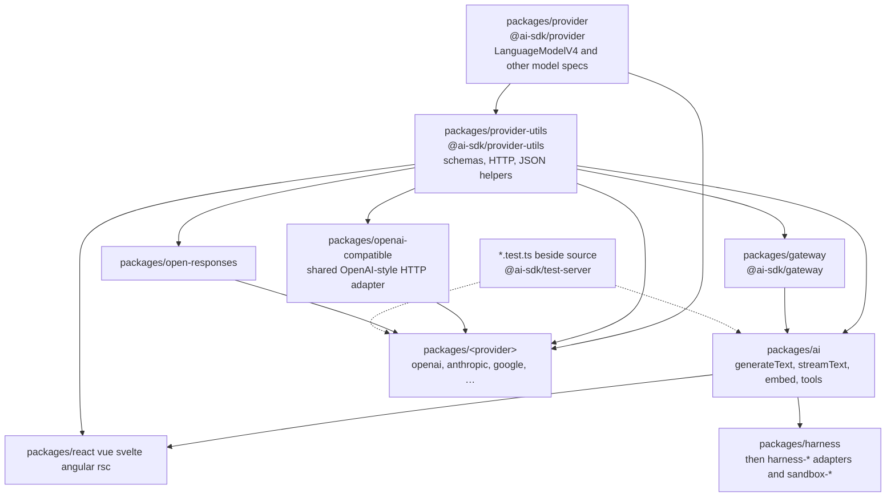

# How this repository fits together

pnpm workspace (`packages/*`, `apps/*`, `examples/*`, `tools/*`). Published libraries live under `packages/`. Deeper model-type notes are in [`architecture/`](../architecture/provider-abstraction.md).

Arrows point from a package to the packages that import it.

## Layers

| Layer                         | Where                                                                                                   | Depends on                                                                                                                                                                                                                                                                                                                                |
| ----------------------------- | ------------------------------------------------------------------------------------------------------- | ----------------------------------------------------------------------------------------------------------------------------------------------------------------------------------------------------------------------------------------------------------------------------------------------------------------------------------------- |
| Spec                          | `packages/provider`                                                                                     | nothing in this repo                                                                                                                                                                                                                                                                                                                      |
| Shared implementation helpers | `packages/provider-utils`                                                                               | `@ai-sdk/provider`                                                                                                                                                                                                                                                                                                                        |
| Core functions                | `packages/ai` (`src/generate-text`, `src/embed`, `src/ui`, …)                                           | `@ai-sdk/provider`, `@ai-sdk/provider-utils`, `@ai-sdk/gateway`                                                                                                                                                                                                                                                                           |
| Gateway                       | `packages/gateway`                                                                                      | provider + provider-utils                                                                                                                                                                                                                                                                                                                 |
| Provider adapters             | `packages/openai`, `packages/anthropic`, `packages/google`, and the other `packages/<provider>` folders | provider + provider-utils. Some also wrap `@ai-sdk/openai-compatible` (baseten, cerebras, deepinfra, fireworks, gmicloud, huggingface, togetherai, zai) or `@ai-sdk/open-responses` (quiverai). Azure wraps openai and deepseek. Amazon Bedrock wraps anthropic and openai. Google Vertex wraps anthropic, google, and openai-compatible. |
| UI                            | `packages/react`, `vue`, `svelte`, `angular`, `rsc`                                                     | `ai` (React also uses `@ai-sdk/mcp`)                                                                                                                                                                                                                                                                                                      |
| Agents                        | `packages/harness`, `packages/harness-*`, `packages/sandbox-*`                                          | `ai` and/or `@ai-sdk/harness`                                                                                                                                                                                                                                                                                                             |

`ai` does not depend on individual provider packages at runtime. A few of them (`openai`, `google`, `xai`, and others) are **devDependencies** of `packages/ai`, used only by its tests.

## Tests

- Unit tests are Vitest files named `*.test.ts` (and `*.test-d.ts` for types) next to the source they cover. Fixtures sit in `__fixtures__`; snapshots sit in `__snapshots__`.
- Package scripts are `pnpm test`, `pnpm test:node`, and `pnpm test:edge` inside that package.
- Provider tests talk to `@ai-sdk/test-server` (`packages/test-server`). They do not call live provider APIs and do not need secrets.
- Runnable scripts live in `examples/ai-functions/src/<function>/<provider>/`, with `basic.ts` as the entry example.
