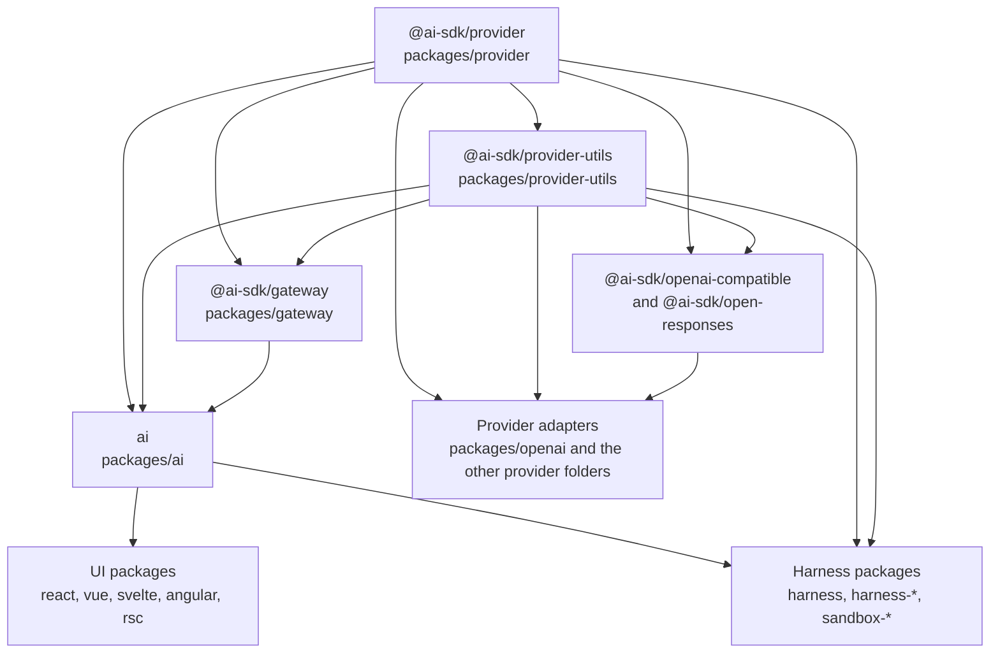
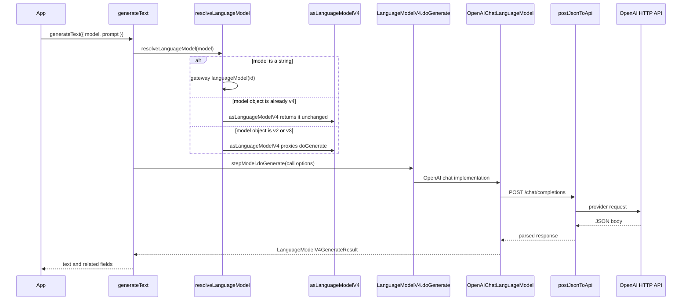

# How this repository fits together

The AI SDK is a TypeScript library for calling language models through one interface. An application picks a model, calls a function such as `generateText`, and receives a normalized result. Provider-specific HTTP lives in adapter packages. The core package does not import those adapters.

This page is the map for a first change. Model-type details (embeddings, images, speech, video, reasoning mapping) stay in [`architecture/provider-abstraction.md`](../architecture/provider-abstraction.md). Day-to-day commands and conventions stay in [`AGENTS.md`](../AGENTS.md).

## Layers

| Layer              | Package                                                                                            | Responsibility                                                                                                                                    |
| ------------------ | -------------------------------------------------------------------------------------------------- | ------------------------------------------------------------------------------------------------------------------------------------------------- |
| Specification      | `@ai-sdk/provider` (`packages/provider`)                                                           | Model interfaces such as `LanguageModelV4`, including `doGenerate`. No dependency on other workspace packages.                                    |
| Shared helpers     | `@ai-sdk/provider-utils` (`packages/provider-utils`)                                               | Schemas, `postJsonToApi`, JSON parsing. Depends on `@ai-sdk/provider`.                                                                            |
| Gateway            | `@ai-sdk/gateway` (`packages/gateway`)                                                             | Default provider used when `generateText` is given a model id string. Depends on provider and provider-utils.                                     |
| Core               | `ai` (`packages/ai`)                                                                               | `generateText`, `streamText`, and the other AI functions. Depends on provider, provider-utils, and gateway.                                       |
| Adapters           | `packages/openai`, `packages/anthropic`, `packages/google`, and the other provider folders         | Implement the spec and talk to one vendor. A direct adapter such as OpenAI depends on provider and provider-utils only.                           |
| Shared HTTP shapes | `@ai-sdk/openai-compatible`, `@ai-sdk/open-responses`                                              | Reusable request stacks. Some adapters depend on them (for example Together depends on openai-compatible). OpenAI itself does not.                |
| UI and agents      | `packages/react` (and vue, svelte, angular, rsc); `packages/harness` and `harness-*` / `sandbox-*` | Framework hooks and agent runners. They depend on `ai`. React also depends on `@ai-sdk/mcp`. Harness also depends on provider and provider-utils. |

Application code imports `ai` and the adapter it wants. That wiring is not a dependency of `packages/ai`. A few adapters (`@ai-sdk/openai` and others) appear in `packages/ai` **devDependencies** so core tests can construct them. Those are not runtime dependencies.

## Package imports

Arrow direction: **A → B means B lists A under `dependencies`.** The arrow points at the importer. Dev-dependencies are omitted so the diagram stays a runtime import map. Tests are not a package on this graph.

Grouped on purpose: individual OpenAI-compatible adapters (baseten, cerebras, deepinfra, fireworks, gmicloud, huggingface, togetherai, zai), open-responses consumers (quiverai), and wrappers (Azure around openai and deepseek, Amazon Bedrock around anthropic and openai, Google Vertex around anthropic, google, and openai-compatible) follow the same adapter node. Confirm a specific folder’s `package.json` before editing it.

## One runtime path: OpenAI chat adapter

This diagram is one example: the app passes an OpenAI chat model object into `generateText`. It is a call sequence, not an import graph. `packages/ai` does not import `@ai-sdk/openai`. Other adapters implement `doGenerate` with their own URL. A string model id is the dashed case in the canvas: it uses `@ai-sdk/gateway`, then that model’s `doGenerate`, and it does not call `POST /chat/completions`.

Verified against:

- [`packages/ai/src/generate-text/generate-text.ts`](../packages/ai/src/generate-text/generate-text.ts) — `resolveLanguageModel` then `stepModel.doGenerate`.
- [`packages/ai/src/model/resolve-model.ts`](../packages/ai/src/model/resolve-model.ts) — strings go to the global gateway provider; objects go through `asLanguageModelV4`.
- [`packages/ai/src/model/as-language-model-v4.ts`](../packages/ai/src/model/as-language-model-v4.ts) — v4 models are returned as themselves; older specs are wrapped.
- [`packages/provider/src/language-model/v4/language-model-v4.ts`](../packages/provider/src/language-model/v4/language-model-v4.ts) — `doGenerate` on the interface.
- [`packages/openai/src/chat/openai-chat-language-model.ts`](../packages/openai/src/chat/openai-chat-language-model.ts) — `doGenerate` calls `postJsonToApi` at path `/chat/completions`.
- [`packages/ai/src/generate-text/generate-text.test.ts`](../packages/ai/src/generate-text/generate-text.test.ts) and [`packages/openai/src/chat/openai-chat-language-model.test.ts`](../packages/openai/src/chat/openai-chat-language-model.test.ts).

Other providers implement the same interface with their own URL and response mapping. A string model id is a different branch: it uses `@ai-sdk/gateway`, which is a real dependency of `ai`, and then that model’s `doGenerate`.

## Where would I change this?

| Change                                                       | Start here                                                                                                     | Nearby tests                                                    |
| ------------------------------------------------------------ | -------------------------------------------------------------------------------------------------------------- | --------------------------------------------------------------- |
| Wording or shape of the result `generateText` returns        | `packages/ai/src/generate-text/generate-text.ts`                                                               | `packages/ai/src/generate-text/generate-text.test.ts`           |
| How a model argument is accepted                             | `packages/ai/src/model/resolve-model.ts`                                                                       | tests that call `generateText` with a mock model in that folder |
| The interface every adapter must satisfy                     | `packages/provider/src/language-model/v4/language-model-v4.ts`                                                 | provider package tests; this is a wide change                   |
| OpenAI chat request or response mapping                      | `packages/openai/src/chat/openai-chat-language-model.ts` and `packages/openai/src/chat/openai-chat-options.ts` | `packages/openai/src/chat/openai-chat-language-model.test.ts`   |
| Another provider’s options                                   | `packages/<provider>/src/` options file next to the model                                                      | the colocated `*.test.ts`                                       |
| A React hook                                                 | `packages/react`                                                                                               | that package’s tests, after the core behavior exists            |
| Docs and a runnable example for a new public provider option | `content/providers/01-ai-sdk-providers/` and `examples/ai-functions/src/<function>/<provider>/`                | example scripts are not the unit tests                          |

## Contribution boundaries

A first contribution is one published package under `packages/`, plus that change’s docs page, example, and a **patch** changeset. No new dependencies. Tests use `@ai-sdk/test-server` and do not call a live provider.

These are different mechanisms:

| Kind          | What it is                                                                                                                                            | What it does not do                                                                                          |
| ------------- | ----------------------------------------------------------------------------------------------------------------------------------------------------- | ------------------------------------------------------------------------------------------------------------ |
| Guidance      | `AGENTS.md`, `.cursor/rules/acme-core.mdc`, `skills/acme-first-contribution/SKILL.md`                                                                 | They tell an agent what to do. They are not a merge gate.                                                    |
| Editor hooks  | `.cursor/hooks.json` runs `tools/acme/hooks/guard-write.mjs` before Write and Edit, and `tools/acme/hooks/stop-check.mjs` when a turn ends            | They apply to Cursor agent edits in this repo. They do not review a pull request on GitHub.                  |
| Local checker | `node tools/acme/check-contribution.mjs`                                                                                                              | Reports first-contribution limit violations. It does not prove the change is correct.                        |
| CODEOWNERS    | [`.github/CODEOWNERS`](../.github/CODEOWNERS) names `@thedavidwells` for `/.cursor/`, `/skills/acme-*`, `/tools/acme/`, `/.github/`, and `/AGENTS.md` | Review requests. Code-owner review is not required on `main`, so this file does not block a merge by itself. |
| Tests         | Vitest beside the source                                                                                                                              | They fail when the asserted behavior changes. A green run is not proof the implementation is bug-free.       |

`docs/ARCHITECTURE.md` has no CODEOWNERS entry. Ownership of this page is unknown from the repository. Platform-owned paths above are attributed to `@thedavidwells` by CODEOWNERS.

## Reading order

1. This page, including both diagrams.
2. [`architecture/provider-abstraction.md`](../architecture/provider-abstraction.md) only for the model type you will touch.
3. [`AGENTS.md`](../AGENTS.md) sections Provider Development, Testing, and Changesets.
4. The sibling file you expect to copy, then its `*.test.ts`.
5. [`skills/acme-first-contribution/SKILL.md`](../skills/acme-first-contribution/SKILL.md) when you are ready to implement.

## When to review this page

Update this page when any of these change: workspace `dependencies` between the packages in the diagram, the public entry `generateText` / `resolveLanguageModel` / `doGenerate`, or the contribution boundaries in the table above. A new provider that only follows the adapter pattern does not need a new node. A specialist behavior belongs in `architecture/provider-abstraction.md` with a link from here.

A presentation snapshot of the package diagram is [`docs/architecture-packages.svg`](architecture-packages.svg). The Mermaid block above is the source to edit; regenerate the SVG when that block changes.

## Opening this map

Two different actions:

1. **From the repository.** Open this file in a Markdown preview that renders Mermaid. That shows the package diagram and the OpenAI chat runtime example. The SVG next to this file is the same package diagram for a slide or a viewer without Mermaid. The tour command `/acme-codebase-tour` is defined by [`skills/acme-codebase-tour/SKILL.md`](../skills/acme-codebase-tour/SKILL.md), exposed through the repository skill links. It reads this page. With no extra text it is the general tour. With a package or task it stays on that area. If an existing Cursor session does not show it, reload the window and start a new chat. The tour does not implement the change.
2. **The saved local canvas.** “Acme — Understand the Codebase” is a Cursor canvas file on the machine that created it (`canvases/acme-understand-the-codebase.canvas.tsx` under that Cursor project). It is not in git and it is not published. Opening that file again does not rebuild it from this guide. Rebuilding means editing this guide, then updating the canvas from it in a later Cursor session.

Revision checked while writing: `42a72a08ef` on branch `docs/architecture-diagram`, plus the package manifests and files linked above.
